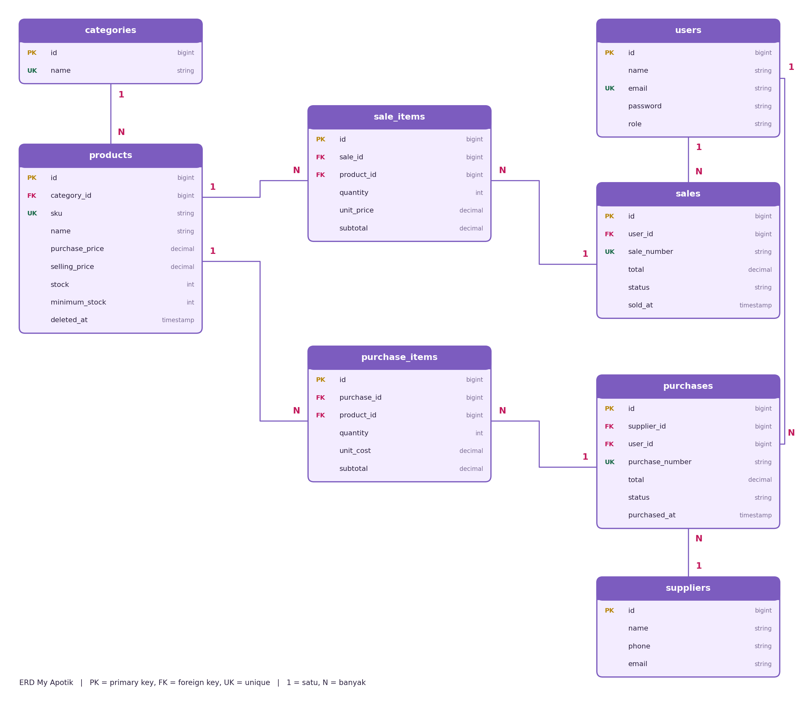
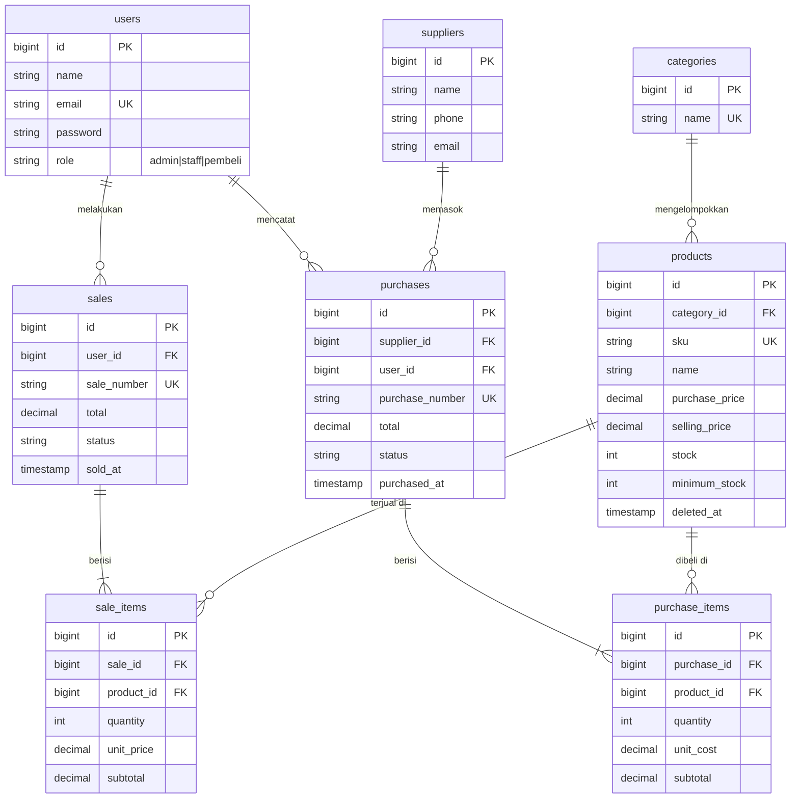

# My Apotik - Inventory & Sales Management (Laravel)

Tugas UTS Web Programming 2. Aplikasi manajemen stok dan penjualan apotik dengan tema warna lilac.
Kategori produk: Vitamin, P3K, dan Obat Herbal.

## 1. Project overview
Aplikasi web berbasis Laravel dan MySQL untuk mengelola kategori, produk, pemasok, pembelian (stok masuk),
penjualan (stok keluar), dashboard, laporan penjualan, dan hak akses per role (Admin, Staff, Pembeli).
Stok berubah otomatis dan konsisten karena transaksi memakai `DB::transaction`.

## 2. Requirements
- PHP 8.1 atau lebih baru (diuji dengan PHP 8.3)
- Composer
- MySQL atau MariaDB (XAMPP atau Laragon)
- Laravel 9

## 3. Installation
```bash
git clone https://github.com/cacandjulia/apotik-laravel-UTS.git
cd apotik-laravel-UTS
composer install
```
Jika Composer menolak karena peringatan keamanan Laravel 9, jalankan:
```bash
composer install --no-security-blocking
```

## 4. Environment setup
```bash
copy .env.example .env        # di Linux/Mac: cp .env.example .env
php artisan key:generate
```
Buat database kosong bernama `apotik_lilac` di MySQL (phpMyAdmin), lalu atur di `.env`:
```
DB_CONNECTION=mysql
DB_HOST=127.0.0.1
DB_PORT=3306
DB_DATABASE=apotik_lilac
DB_USERNAME=root
DB_PASSWORD=
```

## 5. Migration and seeding
```bash
php artisan migrate --seed
php artisan serve
```
Buka http://127.0.0.1:8000 di browser.

## 6. Demo account
| Role | Email | Kata sandi |
|---|---|---|
| Admin | admin@apotik.test | cacabaikhati |
| Staff | staff@apotik.test | sukasukacaca |
| Pembeli | pembeli@apotik.test | pembeli12345 |

Akun dibuat oleh `database/seeders/DatabaseSeeder.php` dan `PembeliSeeder.php`. Kata sandi otomatis di-hash.
Pengunjung baru juga bisa mendaftar sendiri lewat halaman Daftar (otomatis menjadi Pembeli).
Ini hanya akun demo, bukan kredensial asli.

## 7. Features
- Login, logout, pendaftaran akun pembeli, password hashing, CSRF, route terlindungi
- Role dan otorisasi di server (Gate `admin` dan `manage-stock`):
  - Admin: kelola kategori, produk, pemasok, pengguna, laporan penjualan, pembatalan transaksi
  - Staff: lihat produk, buat pembelian dan penjualan, lihat semua penjualan (termasuk dari pembeli)
  - Pembeli: lihat produk, belanja, lihat riwayat belanja sendiri
- Produk: SKU unik, harga jual tidak boleh di bawah harga beli, stok minimum, soft delete
- Pembelian dan penjualan multi-item, total dihitung server, stok tidak cukup ditolak, rollback atomik
- Pembatalan transaksi mengembalikan stok; produk yang sudah bertransaksi tidak bisa dihapus
- Dashboard, daftar stok rendah, laporan penjualan (per hari dan per produk), pencarian, filter, pagination

## 8. Testing
```bash
php artisan test
```
Pengujian mencakup login, validasi produk, pembelian dan penjualan, stok tidak cukup, rollback,
pembatalan, hak akses per role, pendaftaran, laporan, serta pencarian dan pagination.
Sebelum menjalankan test, pastikan `phpunit.xml` memakai database sqlite in-memory
(hapus tanda komentar pada `DB_CONNECTION=sqlite` dan `DB_DATABASE=:memory:`) agar data MySQL tidak terhapus.

## 9. Database design (ERD)



Versi teks (Mermaid, tampil otomatis di GitHub):



### Penjelasan relasi
Foreign key selalu berada di tabel sisi "banyak" (N), karena satu baris di sisi itu hanya menunjuk satu induk.

| Relasi | Jenis | Foreign key | Penjelasan |
|---|---|---|---|
| categories - products | satu ke banyak | `products.category_id` | Satu kategori punya banyak produk. Kategori yang masih dipakai produk tidak bisa dihapus. |
| suppliers - purchases | satu ke banyak | `purchases.supplier_id` | Satu pemasok bisa punya banyak pembelian. |
| users - purchases | satu ke banyak | `purchases.user_id` | Petugas yang mencatat pembelian. |
| users - sales | satu ke banyak | `sales.user_id` | Pembeli atau petugas yang melakukan penjualan. |
| purchases - purchase_items | satu ke banyak (header-detail) | `purchase_items.purchase_id` | Satu nota pembelian berisi banyak barang. |
| sales - sale_items | satu ke banyak (header-detail) | `sale_items.sale_id` | Satu nota penjualan berisi banyak barang. |
| products - purchase_items / sale_items | satu ke banyak | `product_id` | Satu produk bisa muncul di banyak baris transaksi. |

Catatan:
- Hubungan banyak ke banyak antara produk dan penjualan (satu produk dijual di banyak transaksi, satu transaksi berisi banyak produk) dipecah oleh tabel penghubung `sale_items`. Hal yang sama berlaku untuk pembelian lewat `purchase_items`.
- Di model Laravel: `Sale hasMany SaleItem`, `SaleItem belongsTo Sale`, dan seterusnya (lihat folder `app/Models`).
- Tabel detail menyimpan harga saat transaksi (`unit_price`, `unit_cost`), sehingga riwayat tidak berubah ketika harga produk diganti.
- Produk memakai soft delete (`deleted_at`) agar produk yang sudah bertransaksi tidak hilang dari riwayat.

## 10. Known limitations
Tidak ada payment gateway, multi-gudang, atau ekspor laporan PDF (di luar ruang lingkup UTS).
